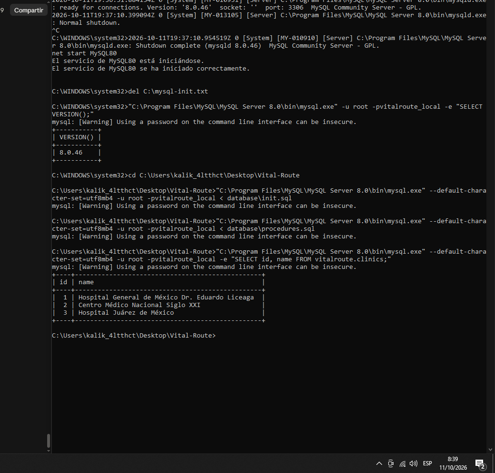
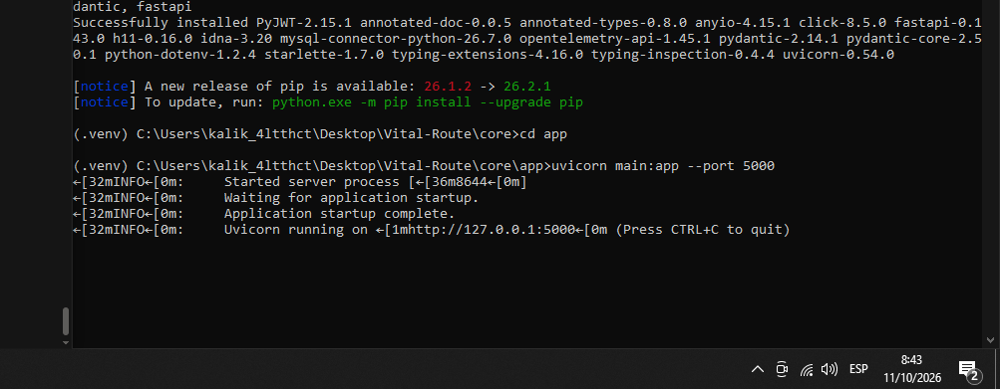
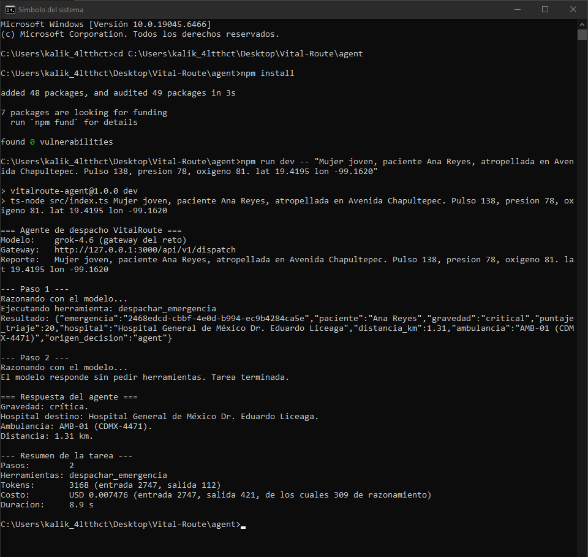
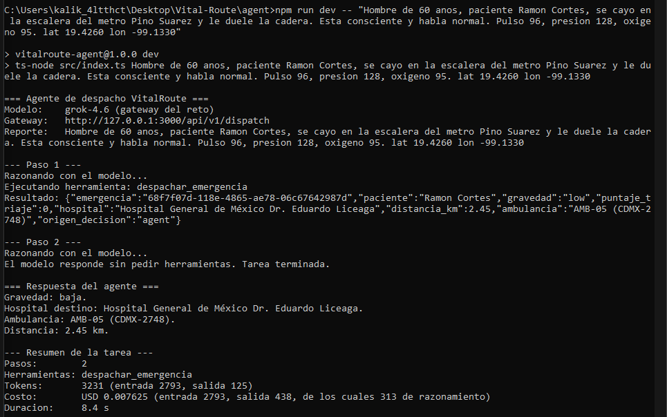
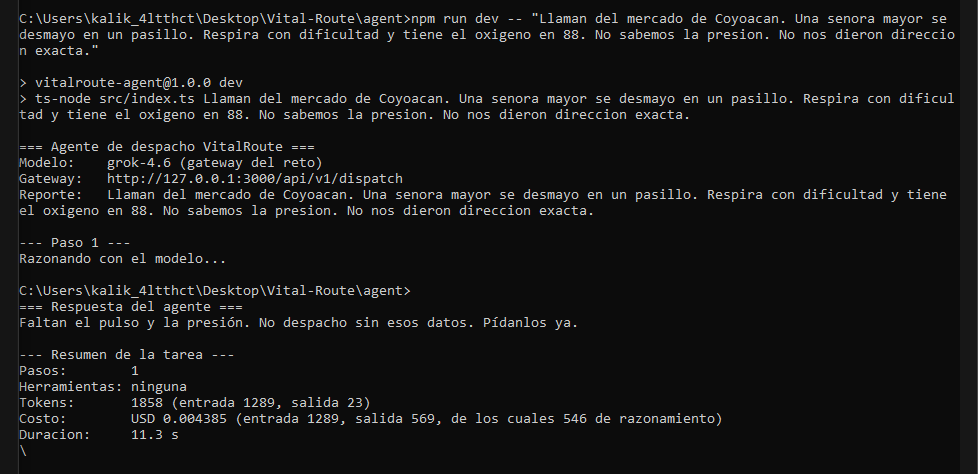
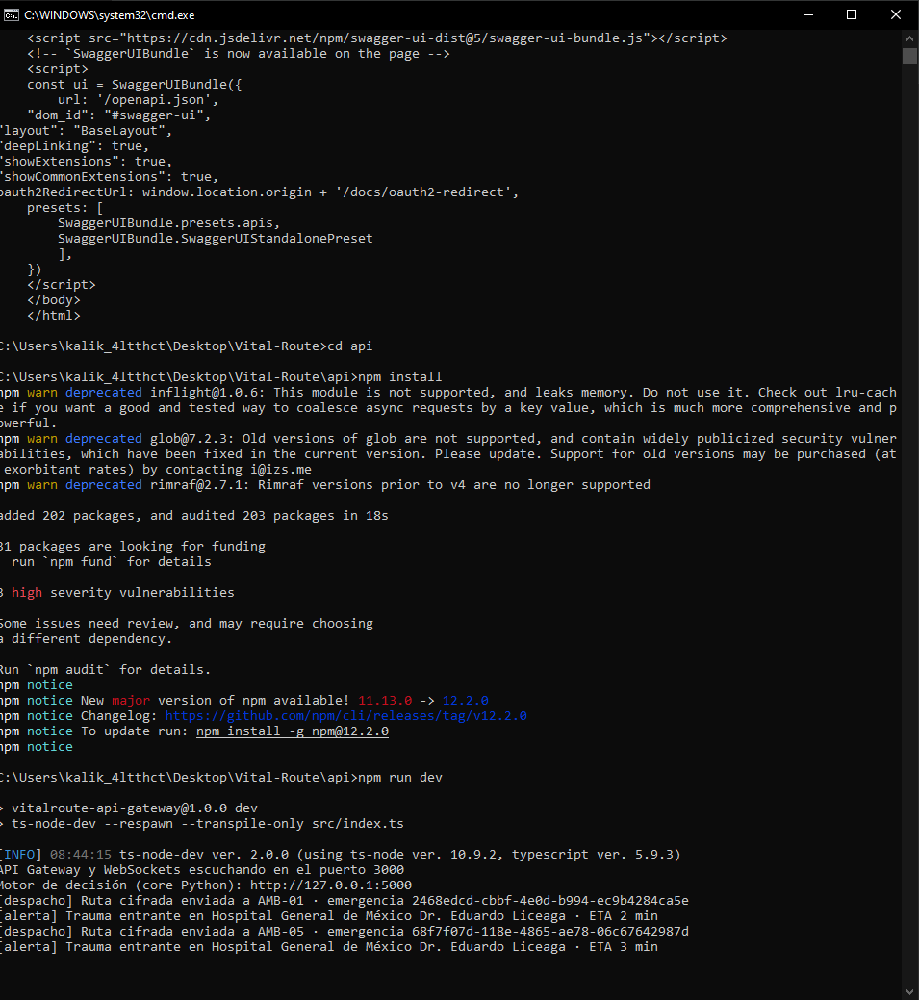

# Reporte tecnico - Sprint 1

**Proyecto:** VitalRoute, despacho de ambulancias para Ciudad de Mexico
**Entrega:** S1, agente corriendo end-to-end
**Repositorio:** https://github.com/santiagoosorio0708e-wq/Vital-Route

**Estado: el agente corre de punta a punta con el sistema completo.** Grok
real, gateway de Node, motor de triaje en Python y MySQL con datos espaciales.
Los numeros de este reporte salen de la corrida del 11 de octubre de 2026.

## El problema

Cuando entra una llamada de emergencia, un operador escucha a alguien
nervioso describiendo lo que ve. No dicta campos de formulario: dice "se cayo
en la escalera del metro y no se puede levantar, respira raro". Alguien tiene
que convertir eso en una decision: que tan grave es, que ambulancia va, a que
hospital, por que ruta.

El Sprint 1 cubre ese salto completo, de la frase a la ambulancia en camino.

## Que se construyo

Un agente que recibe el reporte en lenguaje normal, lo entiende con un modelo
de lenguaje y ejecuta el despacho llamando a las herramientas del sistema.

```
reporte hablado por el operador
          |
          v
    agente (ciclo propio)  <---->  Grok, por el gateway del reto
          |
          v
    herramienta despachar_emergencia
          |
          v
    API Gateway  -->  motor de triaje (Python)  -->  MySQL
          |
          +--> ruta cifrada a la tablet del paramedico
          +--> alerta de trauma entrante al hospital
          +--> actualizacion al centro de mando
```

## El ciclo, que es el corazon del asunto

Esta en `agent/src/core/agent.ts` y cabe en unas cien lineas. En cada vuelta
hace tres cosas:

1. Manda la conversacion al modelo, junto con la lista de herramientas.
2. Si el modelo responde con texto, la tarea termino.
3. Si pide una herramienta, se ejecuta, el resultado se anota en la
   conversacion y se vuelve al paso 1.

Hay un tope de vueltas (`AGENT_MAX_STEPS`, por defecto 5). Sin el, una
herramienta que siempre falle dejaria al agente girando y gastando credito.

Un error de herramienta no detiene al agente: se le devuelve al modelo como
texto, para que decida que hacer. Es el mismo trato que recibe un operador al
que le rebotan una peticion.

## Decisiones y por que

**Framework propio, sin LangChain ni similares.** Una libreria de agentes
habria traido cientos de dependencias y una capa de abstraccion encima de lo
unico que importa: cuando se llama al modelo y cuando se ejecuta una
herramienta. Escrito a mano, el ciclo se lee de principio a fin y se puede
defender frente a un juez linea por linea.

**El modelo detras de una interfaz.** `LlmClient` tiene dos implementaciones:
`GrokClient`, que llama al gateway del reto, y `FakeLlmClient`, un modelo
falso que saca los numeros del texto con expresiones regulares. Cambiar de uno
a otro es una variable de entorno, y el ciclo no se entera. Eso permitio
probar toda la mecanica sin gastar un solo token.

**Una sola herramienta en este sprint.** `despachar_emergencia` recibe nombre,
sintomas, los tres signos vitales y la ubicacion. No decide el hospital: de eso
se encarga el motor de triaje. Las herramientas se registran en un catalogo,
asi que agregar las que faltan es un archivo nuevo y una linea en `index.ts`.

**La llave nunca toca el codigo.** Sale de `AGENT_API_KEY` en el `.env`, que
esta en `.gitignore`. Si falta, el agente se detiene con un mensaje claro en
lugar de intentar la llamada.

## Que se probo

El sistema completo se levanto en tres piezas, cada una en su terminal: el
core de Python (puerto 5000), el gateway de Node (puerto 3000) y el agente.
La base MySQL corre como servicio en la misma maquina.





Tres reportes distintos, escritos como los dictaria un operador telefonico:

| Caso | Pasos | Gravedad | Puntaje | Que hizo el agente |
| --- | --- | --- | --- | --- |
| Critico | 2 | critical | 20 | AMB-01 al Hospital General de Mexico, 1.31 km |
| Gravedad media | 2 | low | 0 | AMB-05 al Hospital General de Mexico, 2.45 km |
| Datos incompletos | 1 | - | - | No despacho: pidio los signos vitales que faltaban |

### Caso 1: critico

Atropello en Avenida Chapultepec, pulso 138, presion 78, oxigeno 81. El motor
de triaje lo califico con 20 puntos y gravedad critica. El agente asigno la
ambulancia mas cercana y el hospital con cama disponible.



### Caso 2: gravedad media

Hombre de 60 anos que se cayo en la escalera del metro Pino Suarez, consciente,
con signos casi normales. Este caso es el que destapo el error del recurso 4
(ver "Lo que fallo"). Con la base corregida el despacho sale bien.



### Caso 3: datos incompletos

Falta la presion y no hay ubicacion. Grok no llamo la herramienta. Respondio:

> "Faltan el pulso y la presion. No despacho sin esos datos. Pidanlos ya."

El modelo falso, con ese mismo texto, invento coordenadas y despacho a
"Paciente sin identificar". Esa diferencia es la prueba de que el agente esta
razonando y no rellenando campos.



### Lo que ve el resto del sistema

Mientras el agente trabaja, el gateway hace su parte en tiempo real. En su
terminal aparecen, por cada despacho, la ruta cifrada que va a la tablet de la
ambulancia y la alerta que recibe el hospital con el tiempo estimado de
llegada (2 minutos para AMB-01 y 3 para AMB-05). El caso 3 no genera ninguna
linea, porque no hubo despacho.



**Camino de error.** Con el gateway apagado, la herramienta falla con
`ECONNREFUSED`, el agente se lo cuenta al modelo y cierra reportandolo en
lugar de romperse.

**Compilacion.** TypeScript sin errores en Node 22 y Node 24.

## Lo que fallo y se arreglo

Al conectar por primera vez el core de Python con una base real salieron tres
errores que el modo simulacro escondia. Los tres estaban en la capa de datos
y los tres quedaron corregidos en este sprint.

1. **Coordenadas invertidas.** MySQL espera latitud-longitud por defecto en el
   sistema 4326, y el seed las tenia como longitud-latitud. Resultado: error
   3617 al cargar `init.sql`. Se corrigio con `'axis-order=long-lat'` en
   `init.sql`, en el procedimiento almacenado y en la insercion del core.
2. **El recurso 4 no existia.** El motor de triaje manda los casos de
   gravedad media y baja al recurso 4, y el seed solo tenia del 1 al 3.
   Se agrego "Cama General de Hospitalizacion" y su inventario por clinica.
3. **Acentos rotos.** Los nombres salian como "México" porque la conexion
   usaba latin1. Se fijo `utf8mb4` en el script SQL, en el core de Python y en
   el pool del gateway.

**El calculo de costo estaba mal y hubo que corregirlo.** La primera version
sumaba `prompt_tokens` mas `completion_tokens`, y no cuadraba con el total.
Faltaban los tokens de razonamiento interno de `grok-4.6`, que se cobran y no
aparecen en `completion_tokens`. Ahora la salida se obtiene restando la
entrada del total.

## Limites que conocemos

**El triaje no mira la edad ni el mecanismo.** El caso 2 es un hombre de 60
anos que se cayo por una escalera y le duele la cadera, y el motor lo clasifica
como `low` con puntaje 0 porque sus signos vitales son normales. Un paramedico
lo trataria con mas cuidado. El motor calcula el puntaje solo con pulso,
presion y oxigeno, y mejorarlo es trabajo para un sprint posterior.

**La disponibilidad de camas es simulada.** El inventario por hospital sale
del seed de la base, no de un sistema real. Los hospitales y sus coordenadas
son reales; las camas libres, no.

**El modelo falso sigue siendo util, con su limite.** Sirve para comprobar la
mecanica del ciclo sin gastar credito, no la comprension.

## Costo por tarea

El panel del reto no publica la tarifa del modelo, solo el credito gastado.
Asi que el precio se midio: se anoto el gasto, se corrieron tres tareas y se
volvio a mirar. Subio de 0.02 a 0.04 dolares. Con 8460 tokens en total, eso da
**2.36 dolares por millon de tokens**, que es el valor configurado en
`AGENT_PRICE_IN_USD` y `AGENT_PRICE_OUT_USD`. La suma calculada por el agente
reprodujo el gasto del panel al centavo.

Con el sistema completo, la corrida del 11 de octubre dio:

| Caso | Pasos | Entrada | Salida | Costo USD | Duracion |
| --- | --- | --- | --- | --- | --- |
| Critico | 2 | 2747 | 421 | 0.007476 | 8.9 s |
| Gravedad media | 2 | 2793 | 438 | 0.007625 | 8.4 s |
| Datos incompletos | 1 | 1289 | 569 | 0.004385 | 11.3 s |
| **Promedio** | | | | **0.0065** | 9.5 s |

La salida incluye el razonamiento: 309, 313 y 546 tokens respectivamente. En
el caso incompleto el razonamiento fue casi toda la salida, porque el modelo
gasto el esfuerzo en decidir que no tenia con que despachar. Decidir que no
hay con que despachar cuesta mas que despachar, y fue el caso mas lento.

A este precio, con los 80 dolares asignados al equipo caben unas doce mil
tareas.

## Como se corre

Se necesitan MySQL, el core de Python, el gateway y el agente, cada uno en su
terminal.

```sh
# base de datos (una vez)
mysql --default-character-set=utf8mb4 -u root -p < database/init.sql
mysql --default-character-set=utf8mb4 -u root -p < database/procedures.sql

# terminal 1: core de Python
cd core && python -m venv .venv && .venv/bin/pip install -r requirements.txt
cd app && uvicorn main:app --port 5000

# terminal 2: gateway
cd api && npm install && npm run dev

# terminal 3: agente
cd agent && npm install
npm run dev -- "Mujer joven, paciente Ana Reyes, atropellada en Avenida Chapultepec. Pulso 138, presion 78, oxigeno 81. lat 19.4195 lon -99.1620"
```

En Windows el entorno virtual se activa con `.venv\Scripts\activate`.

Para ensayar sin gastar credito y sin el core de Python, en el `.env`:
`AGENT_FAKE_LLM=true`, `ENABLE_DISPATCH_DRILL=true` y
`AGENT_DISPATCH_PATH=/api/v1/dispatch/drill`.

Los tres casos de prueba estan en `agent/pruebas/reportes.md`.

## Lo que sigue

- Las dos herramientas que faltan, en el Sprint 2.
- Que el triaje considere edad y mecanismo de la lesion.
- Hospitales reales de otras ciudades del pais.
